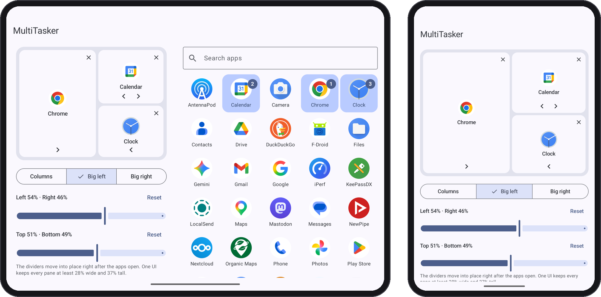
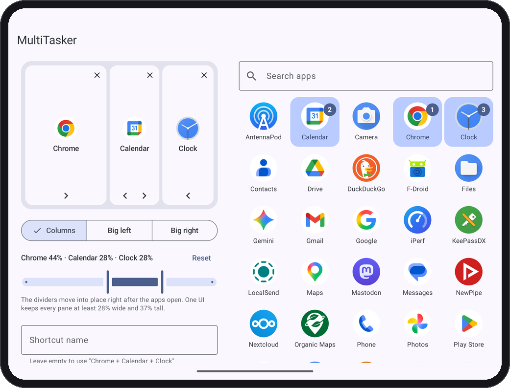
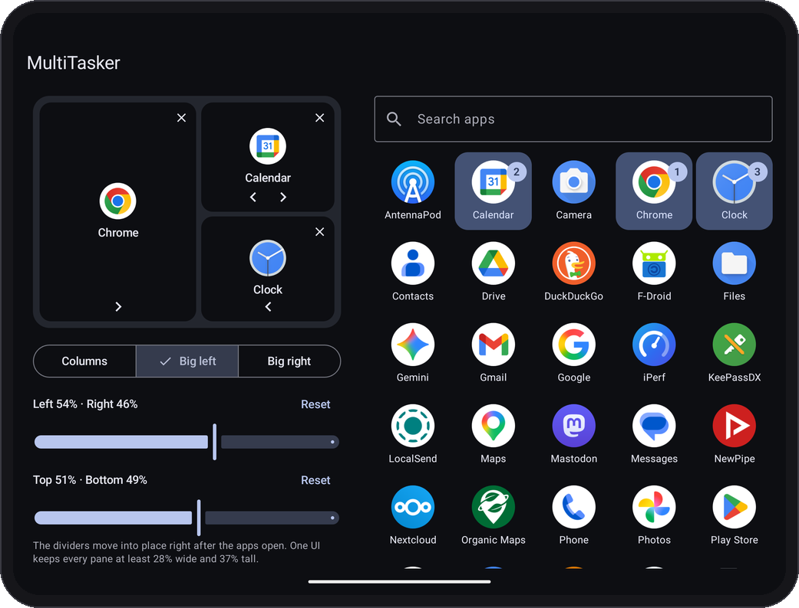

<div align="center">


# MultiTasker

**One tap on your home screen opens two or three apps side by side.**

MultiTasker turns a set of apps into a home screen shortcut that opens them in split screen, in the order and sizes you choose. It's built for the Galaxy Z Fold and One UI 9.

[](https://github.com/JustBuddy/multitasker/releases/latest)


<br>



</div>

## ✨ Features

- **Two or three apps, one shortcut.** Pick the apps, give the shortcut a name and add it to your home screen. Tapping it opens them all in split screen.
- **Three layouts.** Three apps can sit in *Columns*, or as one tall pane with two stacked ones on the *Big left* or *Big right*.
- **Your sizes.** Sliders set how wide and tall each pane is. A preview shows the result before you open anything.
- **Try it first.** *Try it* opens the apps without adding anything to your home screen.
- **Works without setup.** Out of the box you get a 50/50 split of two apps, and a third app opens as a pop-up window. Granting two permissions once over ADB unlocks a real three-pane split ([see below](#-true-split)).
- **Light and dark.** The app follows the system theme and its colour palette.
- **English and German.**

## 📸 Screenshots

| Three columns | Dark mode |
|:---:|:---:|
|  |  |

<sub>The screenshots were taken on the Android emulator, set up like a Galaxy Z Fold8.</sub>

## 📥 Install

1. Download `MultiTasker-<version>.apk` from the [latest release](https://github.com/JustBuddy/multitasker/releases/latest).
2. Open it on your phone. If Android asks, allow your browser or file manager to install apps.
3. Start MultiTasker, pick two or three apps and tap *Add to Home*.

You need Android 14 or newer. Splitting into three panes and custom sizes need One UI on a Galaxy foldable.

## 🪟 What you get

| | No setup | ADB grant ("true split") | ADB grant + accessibility service |
|---|---|---|---|
| 2 apps | Split, 50/50 | Split, left pane 28–72% | same |
| 3 apps, columns | 2-app split + pop-up | 50 / 25 / 25 | Any widths, each column at least 28% |
| 3 apps, one tall + two stacked | 2-app split + pop-up | Tall pane 28–72% wide, stacked pair 50/50 | Stacked pair 37–63% tall |

One UI never makes a split pane narrower than 250dp (656px on the Fold). Narrower drags get clamped or hide the pane, so the limits above keep every pane above that size on the unfolded screen.

### 🔓 True split

True split uses One UI's internal split-screen commands (`WMShell splitscreen startIntents`, `startSplitTasks`, `startIntentToCell`). Reaching them needs two permissions that can only be granted over ADB:

```sh
adb shell pm grant wtf.buddyworks.multitasker android.permission.DUMP
adb shell pm grant wtf.buddyworks.multitasker android.permission.PACKAGE_USAGE_STATS
```

The grant survives updates but not an uninstall. If a One UI update removes the commands, shortcuts fall back to the no-setup behaviour.

### 📐 Three-pane sizes

One UI has no command for three-pane sizes. Its dividers do accept drags to exact positions, so the optional accessibility service *MultiTasker split sizes* drags them into place right after a shortcut opens. It only performs gestures and can't read what's on the screen. Turn it on under **Settings › Accessibility › Installed apps**.

## 🛠️ Build from source

You'll need the Android SDK (API 37) and JDK 17 or newer. Android Studio's bundled JBR works.

```sh
./gradlew assembleRelease        # app/build/outputs/apk/release/app-release.apk
./gradlew lintDebug
adb install -r app/build/outputs/apk/release/app-release.apk
```

<details>
<summary><b>Signing and publishing releases</b> (for maintainers)</summary>

### Signing

Release builds are signed with the key named in `keystore.properties` next to `settings.gradle.kts`. That file is gitignored.

```properties
storeFile=C:/Users/you/.android/multitasker-release.jks
storePassword=…
keyAlias=multitasker
keyPassword=…
```

CI reads the same values from `SIGNING_*` environment variables. If neither is set, release builds fall back to the debug key and Gradle prints a warning. Android won't install a debug-signed copy over a release-signed one, or the other way round, and the ADB grant is lost when you uninstall to switch. Keep a backup of the keystore, because updates only install over a copy signed with the same key.

### Releases

The version lives in `gradle.properties` (`multitasker.version`), and the version code is derived from it. To publish a release:

1. Bump `multitasker.version` and merge.
2. Tag the merge commit `v<version>` and push the tag, for example `git tag v0.2.0 && git push origin v0.2.0`.

The [Release APK](.github/workflows/release.yml) workflow runs lint, builds the signed APK and attaches `MultiTasker-<version>.apk` to a GitHub release for the tag. It fails if the tag and `multitasker.version` don't match. Pull requests run the same build and keep the APK as a run artifact. Only the job that publishes the release can write to the repository.

The workflow needs these repository secrets: `SIGNING_KEYSTORE_BASE64` (the keystore, base64-encoded), `SIGNING_STORE_PASSWORD`, `SIGNING_KEY_ALIAS` and `SIGNING_KEY_PASSWORD`.

</details>

## 🧱 Built with

- [Kotlin](https://kotlinlang.org/) and [Jetpack Compose](https://developer.android.com/compose) with Material 3
- One UI's `WMShell` split-screen commands, reached through `dumpsys`
- An [accessibility service](https://developer.android.com/guide/topics/ui/accessibility/service) that only dispatches gestures, for the divider positions

---

<div align="center">
<sub>Created in <a href="https://t3.codes">T3 Code</a>.</sub>
</div>
